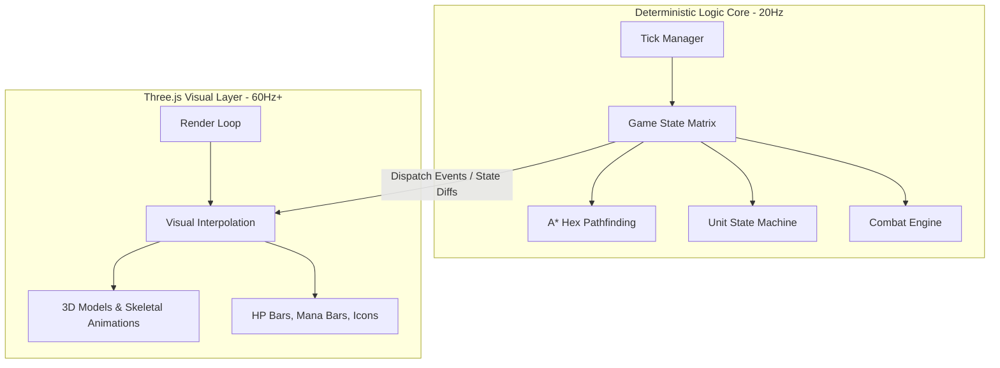

# Part 1: Core Technical Architecture & Systems Design

This document governs the deterministic simulation core, WebGL rendering boundaries, coordinate rounding frameworks, FSM transition rules, locked combat math decisions, project file structure, and the development milestone plan.

> **Solo Developer Note:** This project is being built by one person in free time. Multiplayer is **intentionally deferred** until the core single-player game loop is fully functional. All architecture decisions are made with this constraint in mind.

---

## 0. Technology Stack (Locked)

| Layer | Tool | Version | Purpose |
|-------|------|---------|---------|
| Language | TypeScript | 5.x | Type safety for all game logic |
| Build Tool | Vite | 5.x | Zero-config dev server, fast HMR |
| 3D Renderer | Three.js | r165+ | WebGL visual layer, scene management |
| 3D Models | Blockbench | Latest | Voxel/block unit models, exported as `.glb` |
| State | Plain TS classes | — | No framework needed at this scale |
| Multiplayer | ❌ Deferred | — | Add Colyseus **after** solo game loop works |

### Install Commands (Day 1)
```bash
npm create vite@latest pickaxe -- --template vanilla-ts
cd pickaxe
npm install three @types/three
npm run dev
# Game runs at http://localhost:5173
```

---

## 1. Deterministic Simulation vs. Visual Renderer

To prevent frame-rate-dependent gameplay bugs, the architecture splits the game into a headless logic core and a decoupled visual layer:

*   **Headless Game Engine (The Core):** A pure, stateless logic loop running at a fixed **20Hz tick rate (50ms per tick)**. It manages all state changes — unit positioning, pathfinding, health modifications, FSM transitions — on the grid with complete determinism. **No Three.js code ever runs here.**
*   **Three.js Visual Layer (The View):** A presentation layer running at the monitor's refresh rate (60Hz+). It consumes state diff events emitted by the Core (`onUnitMove`, `onAttackStart`, `onDamageApplied`) and interpolates 3D mesh translations, triggers skeletal animations, and plays particle FX. **No game logic ever runs here.**

> ⚠️ **Critical Rule:** If ANY game logic leaks into the Three.js layer, combat outcomes will differ between clients. The visual layer must be a "dumb display" — it only reads state, never calculates it.



### The 20Hz Tick Loop

The entire simulation is driven by this loop. Build and test it in isolation before anything else:

```typescript
// src/core/tick/TickManager.ts
const TICK_RATE_HZ = 20;
const TICK_MS = 1000 / TICK_RATE_HZ; // 50ms per tick

let lastTick = Date.now();

function gameLoop(): void {
    const now = Date.now();
    const delta = now - lastTick;

    if (delta >= TICK_MS) {
        lastTick = now - (delta % TICK_MS); // drift correction
        tick(); // run one deterministic simulation step
    }

    setImmediate(gameLoop); // prefer setImmediate over setInterval for accuracy
}

gameLoop();
```

> ✅ Verify this outputs **exactly 20 ticks per second** (log a counter for 5 seconds = should print 100) before touching any game logic.

---

## 2. Hexagonal Grid Coordinate System

Aetheria uses a **Cube Coordinate System** $(q, r, s)$ where $q + r + s = 0$ for all grid calculations. This transforms complex hexagonal layouts into lightweight, O(1) distance checks.

The board is **4 columns × 8 rows** of hexes. Each player owns one 4×8 half. During combat, the opponent's board is mirrored onto the top half.

```typescript
// src/core/hex/HexGrid.ts

interface Hex   { q: number; r: number; }
interface Cube  { q: number; r: number; s: number; }

function axialToCube(hex: Hex): Cube {
    return { q: hex.q, r: hex.r, s: -hex.q - hex.r };
}

// O(1) Manhattan Hex Distance
function hexDistance(a: Hex, b: Hex): number {
    const ac = axialToCube(a);
    const bc = axialToCube(b);
    return Math.max(
        Math.abs(ac.q - bc.q),
        Math.abs(ac.r - bc.r),
        Math.abs(ac.s - bc.s)
    );
}

// Returns all 6 neighbors of a hex
const HEX_DIRECTIONS: Hex[] = [
    {q:1,r:0}, {q:1,r:-1}, {q:0,r:-1},
    {q:-1,r:0}, {q:-1,r:1}, {q:0,r:1}
];
function hexNeighbors(hex: Hex): Hex[] {
    return HEX_DIRECTIONS.map(d => ({ q: hex.q + d.q, r: hex.r + d.r }));
}
```

### Raycast-to-Hex Snapping

Mouse clicks fire raycasts that return floating-point positions. They must snap to the nearest integer hex center:

```typescript
function cubeRound(frac: Cube): Cube {
    let q = Math.round(frac.q);
    let r = Math.round(frac.r);
    let s = Math.round(frac.s);
    const qDiff = Math.abs(q - frac.q);
    const rDiff = Math.abs(r - frac.r);
    const sDiff = Math.abs(s - frac.s);
    if (qDiff > rDiff && qDiff > sDiff) {
        q = -r - s;
    } else if (rDiff > sDiff) {
        r = -q - s;
    } else {
        s = -q - r;
    }
    return { q, r, s };
}
```

### Hex to World Position (Three.js)

To place a Three.js mesh on a hex tile, convert axial coordinates to 3D world position (flat-top hexagons, xz-plane):

```typescript
const HEX_SIZE = 1.0; // radius in Three.js world units

function hexToWorld(hex: Hex): THREE.Vector3 {
    const x = HEX_SIZE * (3/2 * hex.q);
    const z = HEX_SIZE * (Math.sqrt(3)/2 * hex.q + Math.sqrt(3) * hex.r);
    return new THREE.Vector3(x, 0, z);
}
```

---

## 3. Unit FSM (Finite State Machine)

Every unit's lifecycle transitions through a strict Finite State Machine. No state transition is allowed outside the edges defined below:

```
[Idle] ──> [Searching] ──> [Moving] ──> [Attacking] ──> [Casting] ──> [Dying]
  ▲          ▲               │             │              │             │
  │          └───────────────┼─────────────┴──────────────┘             ▼
  └──────────────────────────┴───────────[Stunned] ─────────────────> [Dead]
```

### State Definitions

| State | Description | Allowed Transitions |
|-------|-------------|---------------------|
| **Idle** | Standing by at round start. | → Searching |
| **Searching** | Target scanner sweeps for nearest enemy in hex distance. | → Moving, → Attacking |
| **Moving** | Executing A* pathfinding strides toward target. | → Searching (target lost), → Attacking (in range) |
| **Attacking** | Executing a basic attack. Mana generated per hit. | → Searching, → Casting (mana full) |
| **Casting** | Executing active skill. Mana reset to 0 on cast start. | → Attacking, → Searching |
| **Stunned** | Disabled state. All movement and actions suspended. | → Searching (on expiry) |
| **Dying** | Death interrupt: clears target markers, disables collision. | → Dead |
| **Dead** | Removed from simulation. Triggers reanimation checks. | *(terminal)* |

### TypeScript Implementation

```typescript
// src/core/fsm/UnitFSM.ts
type FSMState = 'Idle' | 'Searching' | 'Moving' | 'Attacking' | 'Casting' | 'Stunned' | 'Dying' | 'Dead';

const VALID_TRANSITIONS: Record<FSMState, FSMState[]> = {
    Idle:       ['Searching'],
    Searching:  ['Moving', 'Attacking'],
    Moving:     ['Searching', 'Attacking', 'Stunned'],
    Attacking:  ['Searching', 'Casting', 'Stunned', 'Dying'],
    Casting:    ['Attacking', 'Searching', 'Stunned', 'Dying'],
    Stunned:    ['Searching'],
    Dying:      ['Dead'],
    Dead:       [],
};

function transition(unit: Unit, next: FSMState): void {
    const allowed = VALID_TRANSITIONS[unit.state];
    if (!allowed.includes(next)) {
        console.error(`Invalid FSM: ${unit.state} → ${next} on unit ${unit.id}`);
        return;
    }
    unit.state = next;
}
```

---

## 4. Stat Modification & Buff Pipeline

To prevent permanent stat leaks, units calculate their stats dynamically each tick. Flat and percentage modifiers are stored in a separate buffer list, never merged into base stats:

```typescript
// src/core/stats/ModifierPipeline.ts

interface Modifier {
    id:       string;
    source:   'item' | 'synergy' | 'skill' | 'debuff';
    type:     'flat' | 'percent';
    statType: 'HP' | 'DEF' | 'MDEF' | 'AttackSpeed' | 'ATK' | 'AP';
    value:    number;
    duration: number; // remaining ticks, -1 = permanent
}

function getActualStat(baseStat: number, modifiers: Modifier[], statType: string): number {
    const flats    = modifiers.filter(m => m.statType === statType && m.type === 'flat');
    const percents = modifiers.filter(m => m.statType === statType && m.type === 'percent');

    const flatSum    = flats.reduce((sum, m) => sum + m.value, 0);
    const percentSum = percents.reduce((sum, m) => sum + m.value, 0);

    // Flat stats: additive
    // Percent stats: additive sum applied to base (not compound)
    return (baseStat + flatSum) * (1 + percentSum / 100);
}
```

### Cumulative Formula

*   **Flat Stats (HP, DEF, MDEF):**

$$\text{Actual Stat} = (\text{Base Stat} + \sum \text{FlatModifiers}) \times (1 + \sum \text{PercentModifiers}\%)$$

*   **All modifiers expire by ticking down** `duration` each game tick. Remove any modifier where `duration === 0`.

---

## 5. Locked Combat Math Decisions

These values are **final and locked**. All systems (items, synergies, skills) are balanced against these formulas. Do not change without re-auditing every unit in `5_unit_roster.md`.

### 5.1 DEF / MDEF Mitigation Formula

Uses the **percentage armor formula** (same as League of Legends / TFT):

$$\text{Damage Taken} = \text{Raw Damage} \times \frac{100}{100 + \text{DEF (or MDEF)}}$$

| DEF Value | Damage Taken | Reduction |
|-----------|-------------|-----------|
| 0 | 100% | 0% |
| 25 (1-cost tank) | 80% | 20% |
| 50 (3-cost tank) | 67% | 33% |
| 70 (5-cost boss) | 59% | 41% |
| 100 (item stacked) | 50% | 50% |

> This formula provides **diminishing returns** — stacking DEF never creates a hard damage wall.

**True Damage** (from burn effects, execute thresholds) **bypasses this formula entirely** and applies directly to HP.

### 5.2 Attack Speed Cap

```
Maximum Attack Speed = 3.0 attacks/second
```

Apply this as a hard clamp after all modifiers are summed:

```typescript
const ATTACK_SPEED_CAP = 3.0;
unit.effectiveAttackSpeed = Math.min(getActualStat(unit.baseAttackSpeed, unit.modifiers, 'AttackSpeed'), ATTACK_SPEED_CAP);
```

> At 3.0 attacks/sec, the minimum attack interval is **333ms** — fast enough to feel impactful, slow enough for 3D skeletal animations to remain readable.

### 5.3 Full Damage Pipeline (Step-by-Step)

Execute in this exact order every time a damage event occurs:

```
Step 1 ── Calculate Raw Damage
          raw = (unit.ATK or unit.AP) × skillMultiplier

Step 2 ── Apply DEF Shred modifiers to target (if any active)
          effectiveDEF = target.DEF × (1 - shredPercent)

Step 3 ── Apply Mitigation Formula
          mitigated = raw × 100 / (100 + effectiveDEF or effectiveMDEF)

Step 4 ── Apply Damage Amplification buffs (attacker side)
          amplified = mitigated × (1 + Σ AmpModifiers%)

Step 5 ── Apply Damage Reduction debuffs (target side, e.g. Iron Will)
          final = amplified × (1 - Σ ReductionModifiers%)

Step 6 ── Subtract from target HP
          target.currentHP -= final

Step 7 ── Apply Lifesteal to attacker (post-mitigation)
          attacker.currentHP += final × lifestealPercent

Step 8 ── Check death threshold
          if (target.currentHP <= 0) → trigger FSM transition → Dying
```

```typescript
// src/core/combat/CombatEngine.ts
function resolveDamage(attacker: Unit, target: Unit, rawDamage: number, damageType: 'physical' | 'magic' | 'true'): number {
    if (damageType === 'true') {
        target.currentHP -= rawDamage;
        return rawDamage;
    }

    const defense = damageType === 'physical' ? target.effectiveDEF : target.effectiveMDEF;
    const mitigated  = rawDamage * (100 / (100 + defense));
    const amplified  = mitigated  * (1 + attacker.damageAmpModifier);
    const finalDmg   = amplified  * (1 - target.damageReductionModifier);

    target.currentHP -= finalDmg;
    attacker.currentHP += finalDmg * attacker.lifestealPercent; // lifesteal on post-mitigation

    if (target.currentHP <= 0) transition(target, 'Dying');

    return finalDmg;
}
```

---

## 6. Project File Structure

```
pickaxe/
├── index.html
├── vite.config.ts
├── tsconfig.json
├── package.json
│
├── public/
│   └── models/                   ← Blockbench .glb exports go here
│       ├── units/
│       │   ├── vanguard_squire.glb
│       │   └── archer_apprentice.glb
│       └── board/
│           └── hex_tile.glb
│
└── src/
    ├── main.ts                   ← Entry point, boots Core + View
    │
    ├── core/                     ← ALL GAME LOGIC — no Three.js imports allowed here
    │   ├── tick/
    │   │   └── TickManager.ts    ← 20Hz deterministic loop
    │   ├── hex/
    │   │   └── HexGrid.ts        ← Cube coordinates, distance, neighbors, A*
    │   ├── fsm/
    │   │   └── UnitFSM.ts        ← State machine transitions
    │   ├── stats/
    │   │   └── ModifierPipeline.ts ← Flat/percent buff stacking
    │   ├── combat/
    │   │   └── CombatEngine.ts   ← Damage pipeline (Section 5.3)
    │   ├── board/
    │   │   └── BoardState.ts     ← 4×8 grid, unit placement
    │   ├── units/
    │   │   └── UnitFactory.ts    ← Spawns unit instances from roster data
    │   ├── shop/
    │   │   └── ShopManager.ts    ← Gold economy, shop rolls, XP
    │   └── events/
    │       └── EventBus.ts       ← Core → View event dispatch
    │
    └── view/                     ← ALL VISUALS — no game logic allowed here
        ├── SceneManager.ts       ← Three.js scene, camera, renderer, lights
        ├── BoardView.ts          ← Renders hex tiles on the grid
        ├── UnitView.ts           ← Loads .glb models, positions, animates
        ├── EventBridge.ts        ← Subscribes to EventBus → drives animations
        ├── UIOverlay.ts          ← HP bars, mana bars, unit names (HTML/CSS overlay)
        └── ParticleSystem.ts     ← Skill VFX
```

---

## 7. EventBus (Core → View Communication)

The Core never calls Three.js. Instead, it fires typed events that the View layer subscribes to:

```typescript
// src/core/events/EventBus.ts

type GameEvent =
    | { type: 'UNIT_MOVED';     unitId: string; from: Hex; to: Hex }
    | { type: 'ATTACK_START';   unitId: string; targetId: string }
    | { type: 'DAMAGE_APPLIED'; unitId: string; amount: number; damageType: 'physical' | 'magic' | 'true' }
    | { type: 'UNIT_DIED';      unitId: string }
    | { type: 'SKILL_CAST';     unitId: string; skillId: string }
    | { type: 'SHIELD_APPLIED'; unitId: string; amount: number }
    | { type: 'ROUND_START' }
    | { type: 'ROUND_END';      winnerId: 'player' | 'enemy' };

type Listener<T extends GameEvent> = (event: T) => void;

class EventBus {
    private listeners: Map<string, Listener<any>[]> = new Map();

    on<T extends GameEvent>(type: T['type'], cb: Listener<T>): void {
        if (!this.listeners.has(type)) this.listeners.set(type, []);
        this.listeners.get(type)!.push(cb);
    }

    emit(event: GameEvent): void {
        this.listeners.get(event.type)?.forEach(cb => cb(event));
    }
}

export const bus = new EventBus();
```

```typescript
// src/view/EventBridge.ts  — View subscribes to Core events
bus.on('UNIT_MOVED', (e) => unitView.animateMove(e.unitId, e.to));
bus.on('DAMAGE_APPLIED', (e) => uiOverlay.flashDamage(e.unitId, e.amount));
bus.on('UNIT_DIED', (e) => unitView.playDeathAnimation(e.unitId));
bus.on('SKILL_CAST', (e) => particleSystem.playSkillFX(e.unitId, e.skillId));
```

---

## 8. Blockbench Model Pipeline

Units are created in **Blockbench** (free, browser or desktop) and exported as `.glb` files for Three.js.

### Blockbench Setup Checklist
1. Use the **"Generic Model"** or **"Java Block/Item"** project type for voxel-style units.
2. Set up an **armature (rig)** with at least these bones: `root`, `body`, `head`, `arm_l`, `arm_r`, `leg_l`, `leg_r`.
3. Create named animations inside Blockbench:
    - `idle` — subtle bob or breathing loop
    - `walk` — movement cycle
    - `attack` — strike motion
    - `cast` — spell channel pose
    - `die` — fall/dissolve animation
4. Export: **File → Export → Export GLTF/GLB** → save to `public/models/units/`.

### Loading in Three.js

```typescript
// src/view/UnitView.ts
import * as THREE from 'three';
import { GLTFLoader } from 'three/addons/loaders/GLTFLoader.js';

const loader = new GLTFLoader();

async function loadUnit(modelPath: string): Promise<THREE.Group> {
    return new Promise((resolve, reject) => {
        loader.load(modelPath, (gltf) => resolve(gltf.scene), undefined, reject);
    });
}

// Play a named Blockbench animation
function playAnimation(mixer: THREE.AnimationMixer, gltf: GLTF, name: string): void {
    const clip = THREE.AnimationClip.findByName(gltf.animations, name);
    if (!clip) return;
    mixer.stopAllAction();
    mixer.clipAction(clip).play();
}
```

---

## 9. Development Milestone Plan

Build in this order. **Do not skip ahead** — each phase depends on the previous one working correctly.

### Phase 0 — Foundations *(No graphics, just code)*
- [ ] `HexGrid.ts`: cube coords, distance, neighbors — **write unit tests**
- [ ] `TickManager.ts`: 20Hz loop, verify with console logging
- [ ] `UnitFSM.ts`: state transitions, invalid transition guard
- [ ] `ModifierPipeline.ts`: flat/percent formula
- [ ] `CombatEngine.ts`: full damage pipeline (Section 5.3)

### Phase 1 — Something Visible
- [ ] Three.js scene: camera (top-down isometric), lights, renderer
- [ ] `BoardView.ts`: render a 4×8 hex grid with flat tiles
- [ ] Load one `.glb` from Blockbench and place it on a tile
- [ ] Click a tile → model moves to that position

### Phase 2 — Basic Combat
- [ ] Two units placed on the board walk toward each other
- [ ] Basic attack fires (no animation — just damage event + console log)
- [ ] HP bars rendered as HTML overlay above units
- [ ] One unit reaches 0 HP → removed from board

### Phase 3 — Core Game Loop
- [ ] Shop UI: 5 unit slots, buy button, drag to board
- [ ] Gold economy: earn gold per round, interest, streak bonus
- [ ] Preparation phase (30s timer) → combat phase → result screen
- [ ] AI opponent: random unit placement to fight against

### Phase 4 — Game Depth
- [ ] Items: pick up components, combine into completed items
- [ ] Synergy detection: count traits on board → apply bonuses
- [ ] Unit star-up: 3 copies → 2★ upgrade
- [ ] All 61 units with Blockbench models and skill visuals

### Phase 5 — Polish & Multiplayer *(Later)*
- [ ] Add Colyseus server for real-time PvP
- [ ] Spectator view
- [ ] Ranked matchmaking

---

## 10. Key Rules Summary

| Rule | Value |
|------|-------|
| Tick rate | 20Hz (50ms per tick) |
| Board size | 4 columns × 8 rows (hex grid) |
| Coordinate system | Cube axial (q, r, s) |
| DEF/MDEF formula | `damage × 100 / (100 + DEF)` |
| Attack speed cap | 3.0 attacks/sec |
| Damage pipeline order | Raw → DEF Shred → Mitigate → Amp → Reduce → HP deduct → Lifesteal |
| True damage | Bypasses DEF/MDEF entirely |
| Lifesteal base | Calculated on **post-mitigation** final damage |
| Game logic in View? | ❌ Never |
| Three.js in Core? | ❌ Never |
| Multiplayer | Deferred — build solo game loop first |
